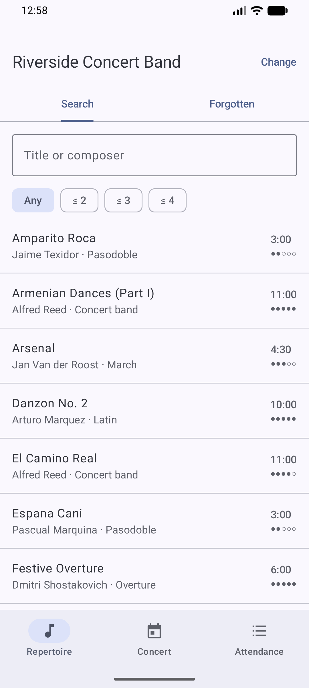
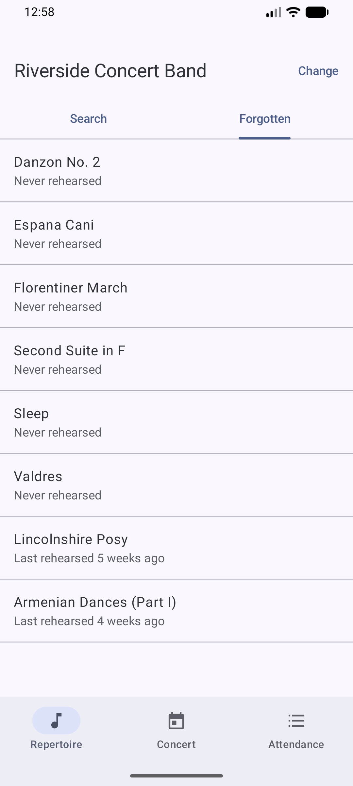
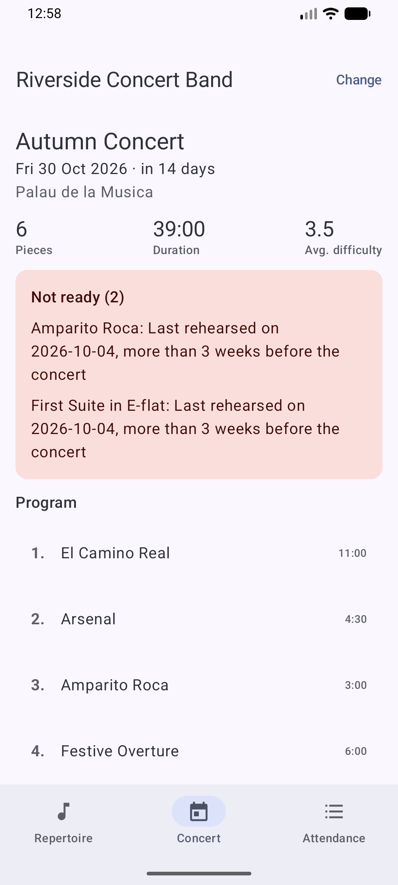
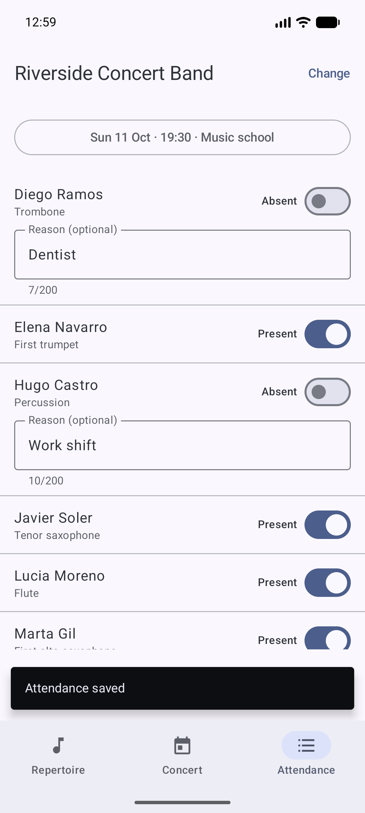

# Band Repertoire Android

[](https://github.com/IvanStgAlej/band-repertoire-android/actions/workflows/ci.yml)

A Kotlin + Jetpack Compose app for band musicians and conductors, and the client for
[band-repertoire-api](https://github.com/IvanStgAlej/band-repertoire-api). It shows the repertoire, says which
pieces have been forgotten, tells you whether the next concert is ready, and lets you take attendance at
rehearsals.

| Repertoire | Forgotten pieces | Next concert | Attendance |
|---|---|---|---|
|  |  |  |  |

## Features

- **Repertoire search** by title or composer, with a maximum difficulty filter. Each piece shows its duration
  and difficulty.
- **Forgotten pieces:** what has not been rehearsed for 4 weeks. Pieces that were never rehearsed come first.
- **Next concert:** date, venue, total duration and average difficulty, the program in order, and a warning for
  every piece that is not ready (no rehearsal in the 3 weeks before the concert).
- **Take attendance:** pick a rehearsal, mark members present or absent with an optional reason, and save. The
  sheet is pre-filled with what was already recorded, and changes survive rotating the phone.
- **Clear errors everywhere:** every screen has a loading state, an empty state and an error with **Retry**.
  When the API refuses something, the app shows the API's own message.

## Tech stack

| Area | Technology |
|---|---|
| Language | Kotlin 2.4 |
| UI | Jetpack Compose, Material 3 (dynamic colour), Navigation Compose with type-safe routes |
| Architecture | MVVM with unidirectional data flow: `ViewModel` + `StateFlow` → stateless composables |
| Networking | Retrofit 3 + kotlinx.serialization, OkHttp 5 |
| Storage | DataStore (the selected ensemble) |
| Tests | JUnit 4, kotlinx-coroutines-test (virtual time), MockWebServer |
| Build | Gradle 9.8 (Kotlin DSL, version catalog), Android Gradle Plugin 9.4, R8 |
| CI | GitHub Actions: unit tests, lint, release build, release security checks and a secret scan |

`minSdk` 26 · `targetSdk` 36 · `compileSdk` 37

## Architecture

```
ui/  (feature packages: ensemble, repertoire, concert, attendance)
 │   Screen (stateless composable)  ◄── StateFlow<UiState> ──  ViewModel
 │                                   ──── user events ────►
 ▼
data/  BandRepository ──► NetworkBandRepository ──► Retrofit ApiService ──► band-repertoire-api
       EnsembleSelection (DataStore)
```

- **One source of truth per screen.** Each ViewModel exposes a `StateFlow<UiState<T>>` (Loading, Content or
  Error) and the composable only renders it. Unsaved attendance marks live in the ViewModel, so they survive
  configuration changes.
- **The UI never sees DTOs.** The data layer maps the API's JSON to small domain models. It also turns every
  failure into a message that is safe to show: an RFC 9457 problem detail becomes its `detail` text, a network
  failure becomes "Cannot reach the API…", and anything unexpected becomes a generic message, never a stack
  trace.
- **Search is debounced and cancellable.** Typing waits 300 ms, and `flatMapLatest` cancels the previous request,
  so a slow old response can never overwrite a newer one.
- **Manual dependency injection.** An `AppContainer` builds everything once. The app is small enough that a DI
  framework would add more code than it removes.
- **Time is injected.** Screens that depend on "today" take a `Clock`, so the tests can fix the date.

## Run it

1. Start the API with its demo data. It needs Java 21 (see the
   [API's README](https://github.com/IvanStgAlej/band-repertoire-api)):

   ```bash
   ./mvnw spring-boot:run
   ```

2. Start an Android emulator (API 26 or newer) and install the debug build:

   ```bash
   ./gradlew installDebug
   ```

   The emulator reaches your computer's `localhost` as `10.0.2.2`, which is the app's default API URL. To use
   another URL, for example a physical phone on your Wi-Fi network, pass it at build time:
   `./gradlew installDebug -PapiBaseUrl=http://192.168.1.20:8080/`. It must end with `/`.

> [!NOTE]
> **Debug builds** allow plain HTTP only to `10.0.2.2` and `localhost`. **Release builds** allow HTTPS only, so
> a release build cannot talk to the local demo API. That is intentional; see [Security](#security).

## Testing

```bash
./gradlew testDebugUnitTest
```

- **37 unit tests,** all running on the JVM.
- **Data layer:** tested against MockWebServer. This covers request parameters, JSON parsing, problem-detail
  errors, an unreachable server, malformed responses, picking the next upcoming concert, and the attendance PUT
  body.
- **Every ViewModel:** tested with a fake repository on virtual time. This covers search debouncing, out-of-order
  responses, empty states, retry, the default rehearsal, unsaved-change confirmation, and the 200-character
  reason limit.

The full check that CI runs:

```bash
./gradlew testDebugUnitTest lintRelease assembleRelease verifyReleaseSecurity assembleDebug
```

## Security

This repository is public, so it follows a security checklist, and most of it is checked automatically on every
push. See [SECURITY.md](SECURITY.md) for the details and for how to report a vulnerability.

- **No secrets:** gitleaks scans the full git history in CI. No keystore or signing secret exists anywhere; the
  release build in CI is unsigned.
- **No plain HTTP in release:** the release network security config forbids cleartext traffic. This was checked
  on the emulator: the release build refuses `http://10.0.2.2:8080` even while the API is running.
- **Hardened release build:** the build fails if the release app is debuggable, allows backups, asks for any
  permission other than `INTERNET`, or exports a component without protection (`verifyReleaseSecurity`). R8 is
  on, and HTTP logging exists only in debug builds.
- **Lint security checks are errors:** `app/lint.xml`.
- **Up-to-date dependencies:** Dependabot checks weekly for Gradle and GitHub Actions updates.
- **Demo scope:** the API has no authentication. Run it locally and never expose it to the internet.

## Known limitations

- **Next concert:** the API has no "upcoming" filter, so the app picks the next concert from the 20 most recent
  ones.
- **Search:** results show the first 100 matching pieces.
- **Read-mostly:** creating and editing ensembles, pieces, rehearsals and concerts is done in the API's Swagger
  UI. The app only writes attendance.

## License

MIT
